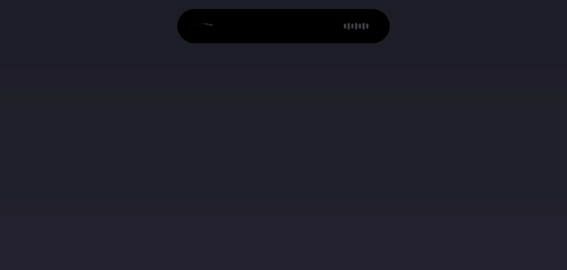

# Islet

A **Dynamic Island** for Windows. It sits at the top or bottom of your screen showing what's playing, and opens into a Now Playing card when you hover over it.

Works with Spotify, Apple Music, and web players such as YouTube Music, Spotify Web and SoundCloud. Official music videos on YouTube show as the songs they are.

*Islet used to be called MusicIsland. Copies installed under the old name switch over by themselves when they update, settings included.*

<p align="center">
  
</p>

## Install

In PowerShell:

```powershell
irm https://raw.githubusercontent.com/Prathambist/Islet/main/install.ps1 | iex
```

The installer asks before changing anything. It adds Start Menu and startup shortcuts and doesn't need .NET installed. It updates itself from then on.

To uninstall:

```powershell
irm https://raw.githubusercontent.com/Prathambist/Islet/main/uninstall.ps1 | iex
```

## Features

**Music**
- **Now Playing:** play, pause, skip, seek, shuffle and repeat. Album art sets the colours.
- **Synced lyrics:** from [LRCLIB](https://lrclib.net), with a timing nudge per song.
- **Music videos as songs:** official videos, lyric videos and audio uploads on YouTube show with the song's name and album cover. Previews, feed clips and other videos stay off.
- **Listening stats:** your top songs, artists and albums over the last five weeks, with covers, play counts, highlights and a recap picture to share. Counted on your PC.
- **Screensaver:** away from the PC for a few minutes while music plays, the cover and the song's synced lyrics fill the screen over a slowly drifting blur of the artwork. It stays away during calls, videos and games; any key or mouse movement brings you back. Turn it on or off in Settings, or open it from the right-click menu.
- **Live visualizer:** bars that move with the music.

**The island**
- **Views:** a pill, a circle, a small pill, a tiny pill or a slim line while music plays; a clock, weather, a tiny clock or a circle when it's idle.
- **Top or bottom:** hold the island for a second and drag it anywhere along either edge. At the bottom it rises above the taskbar, even one that hides itself.
- **Nepali date:** Bikram Sambat in English letters or Nepali (कात्तिक २९).
- **Right-click menu:** the song, the timer, and moving the island, a click away.
- **Hides over full-screen apps:** games and videos.
- **Performance modes:** Low, Medium and High. Themes and sizes too.

**More**
- **Notifications:** from every app, with Discord, WhatsApp and Messenger in their own colours. Turn them off and a yellow dot says when something arrives.
- **Volume and brightness:** shown on the island; scroll over it to change the volume.
- **Mic and camera dots:** like iPhone's.
- **Timer and focus sessions:** 25 minutes in which messages wait, then arrive together.
- **File shelf:** drop files on the island and drag them out later. New screenshots land there too.
- **Colour picker:** pick any colour on screen; its hex code is copied.
- **Files in use:** drag a file Windows won't delete onto the island to see which app has it open.

Everything is set in **Settings**, from the island's right-click menu or the tray icon.

<details>
<summary>Connecting Spotify for the Like button</summary>

Spotify only allows this for accounts with Premium.

1. Create an app at [developer.spotify.com/dashboard](https://developer.spotify.com/dashboard) with **Web API**.
2. Add the redirect URI `http://127.0.0.1:5543/callback`.
3. Paste its **Client ID** into Settings and press **Connect**.

</details>

## Building

Needs the [.NET 10 SDK](https://dotnet.microsoft.com/download/dotnet/10.0).

```powershell
git clone https://github.com/Prathambist/Islet.git
cd Islet
dotnet run --project src/Islet
dotnet test
```

Every push and pull request is built and tested by GitHub Actions, with a coverage report, a dependency audit and CodeQL security scanning.

## Documentation

- [Architecture](docs/ARCHITECTURE.md): how Islet is put together
- [Building and testing](docs/BUILDING.md): build, run, tests and coverage
- [Releasing](docs/RELEASING.md): signing, publishing and the release checklist
- [Security](SECURITY.md): what Islet can access, what it sends where, and how to report a problem
- [Third-party notices](THIRD-PARTY-NOTICES.md): licences for libraries, services and assets
